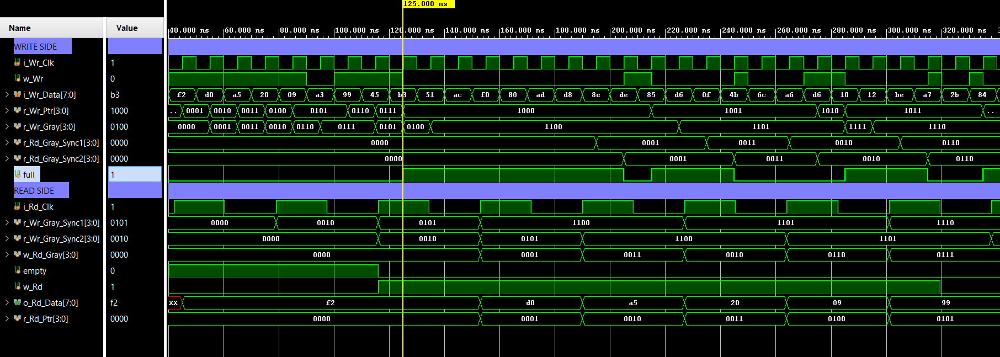
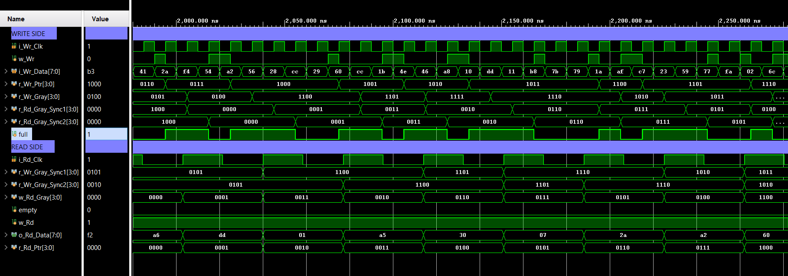
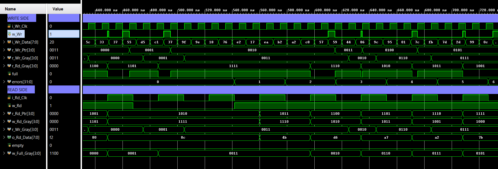
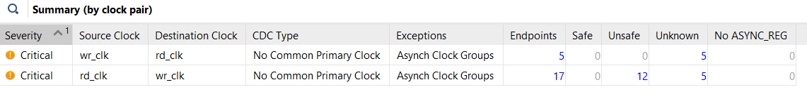

# Asynchronous (Dual-Clock) FIFO in SystemVerilog
Dual-clock async FIFO in SystemVerilog: Gray-coded pointers, 2-flop synchronizers, two-clock self-checking testbench, CDC analysis (Vivado, Arty S7-25).

A FIFO that passes data between two **unrelated clock domains**, designed in SystemVerilog,
verified with a two-clock self-checking testbench, analysed with Vivado's CDC tools,
deliberately broken to see which tools catch which mistakes, and finally tested on a
Spartan-7 FPGA (Digilent Arty S7-25) with two independent oscillators.

This builds on my [synchronous-fifo](https://github.com/micahpinto/synchronous-fifo)
(Method B, the "lap bit" design, is the starting point here).

## Why an asynchronous FIFO?

Inside one clock domain, a normal FIFO is enough. When the writer and reader run on
**different clocks**, two problems appear:

1. **Metastability**: a flip-flop sampling a signal that changes right at its clock edge can
   hang between 0 and 1 for a while. The standard fix for a single bit is a **2-flop synchronizer**.
2. **Multi-bit values**: a bus synchronized bit by bit can arrive with some bits new and some
   old, giving a value that never existed.

An async FIFO solves both: the **data stays in the memory**, and only the read and write
**pointers** cross between the domains, **Gray-coded** (only one bit changes per step) and
each through a **2-flop synchronizer**.

## Design (`design/async_fifo.sv`)

```
      WRITE DOMAIN (wr_clk)                          READ DOMAIN (rd_clk)

 i_Wr_Data ──> [ memory 16 x 8 ] ─────────────────────────────> o_Rd_Data
                   ^ write addr                       ^ read addr
 r_Wr_Ptr ── bin->Gray ── r_Wr_Gray ──> Sync1 ─> Sync2 ──> compare ─> o_Empty
                                        (rd_clk)  (rd_clk)    ^
                                                           r_Rd_Ptr
 o_Full <── compare <── Sync2 <── Sync1 <── r_Rd_Gray ── bin-> Gray ── r_Rd_Ptr
               ^       (wr_clk) (wr_clk)
            r_Wr_Ptr
```

- **Pointers** have one extra "lap" bit (5 bits for 16 slots).
- **Binary -> Gray:** `gray = bin ^ (bin >> 1)`. The Gray value is **registered** before it
  crosses, so only flip-flop outputs cross clock domains (no combinational glitches).
- **Synchronizers:** two flip-flops per bit, marked `(* ASYNC_REG = "TRUE" *)` so Vivado
  places them close together.
- **Empty** (read side): read Gray pointer == synchronized write Gray pointer.
- **Full** (write side): write Gray pointer == synchronized read Gray pointer with the
  **top 2 bits inverted** and the rest equal.
- **Pessimistic but safe:** each side sees the other pointer ~2 clocks late, so `full` and
  `empty` may stay on a little too long, but the FIFO never overwrites unread data and
  never reads an empty slot.

### Interface

| Port | Domain | Meaning |
|---|---|---|
| `i_Wr_Clk`, `i_Wr_En`, `i_Wr_Data` | write | write clock, write request, data in |
| `o_Full` | write | no room (computed in the write domain) |
| `i_Rd_Clk`, `i_Rd_En` | read | read clock, read request |
| `o_Rd_Data` | read | oldest byte, always visible (first-word fall-through) |
| `o_Empty` | read | nothing to read (computed in the read domain) |

Parameters: `WIDTH` (default 8), `DEPTH` (default 16, power of 2).

## Verification (`sim/async_fifo_tb.sv`)

- **Two clocks** whose periods are variables, so the test can change them between phases.
- **Two processes** started together with `fork … join`: a writer on the write clock and a
  reader on the read clock, each with random traffic (~70% of clocks).
- **Reference model:** a SystemVerilog queue. Accepted write -> `push_back`, accepted read ->
  compare with `model[0]`, then `pop_front`.
- **Checks:** data order (every byte read matches the model), no overflow (`full = 0` while the
  model already holds DEPTH bytes is an error), no underflow, nothing lost at the end, and a
  watchdog timeout.
- The flags are **not** checked cycle-exactly, because they are late by design. A late flag is
  fine; a flag that lies is a bug.

| Phase | Write clock | Read clock | Purpose | Result |
|---|---|---|---|---|
| 1 | 10 ns | 37 ns | writer faster -> FIFO fills | 2,000 bytes, 0 errors |
| 2 | 37 ns | 10 ns | reader faster -> FIFO drains | 2,000 bytes, 0 errors |
| 3 | 10 ns | 10.7 ns | almost equal -> edges slide past each other | 2,000 bytes, 0 errors |

Coverage: `full` = 1 on 7,972 write clocks, `empty` = 1 on 7,652 read clocks. **TEST PASSED.**




## Constraints and CDC analysis

`constraints/async_fifo.xdc` defines the two clocks. With only `create_clock`, Vivado assumes
the clocks are related, finds two edges 1 ns apart (110 ns and 111 ns), and reports the
crossings as failing (WNS −0.083 ns, "Timed (unsafe)"). This failure is not real: unrelated
clocks can't be timed, which is why synchronizers exist.

```tcl
set_clock_groups -asynchronous -group wr_clk -group rd_clk
```

tells Vivado not to time paths between the clocks. Because those paths are then **unchecked**,
`report_cdc` is used to check that every crossing is built safely:

| | wr -> rd | rd -> wr |
|---|---|---|
| Endpoints | 5 | 5 |
| Safe | 5 | 5 |
| Unsafe / Unknown / No ASYNC_REG | 0 / 0 / 0 | 0 / 0 / 0 |
| Rule | CDC-6 (warning) | CDC-6 (warning) |

**CDC-6, "Multi-bit synchronized with ASYNC_REG":** every bit has a correct synchronizer, but
Vivado can't know the 5-bit bus is Gray-coded. **Justification:** it is a Gray-coded pointer,
only one bit changes per step, so the receiver sees either the old or the new value, never a
mix.

| Resources / timing (out of context, DEPTH 16 × 8) | |
|---|---|
| Flip-flops | 40 (4 registers × 5 bits × 2 sides) |
| LUTs | 26 (18 logic + 8 distributed RAM) |
| WNS / WHS / WPWS | 6.775 / 0.164 / 3.750 ns |

The synchronous FIFO (Method B) uses 10 flip-flops; the async version uses 40. The extra 30
are the price of crossing clock domains safely.

## Failure analysis: breaking it on purpose (`broken/`)

Two versions, each with exactly **one** mistake, run through the same testbench and the same
`report_cdc`.

| Version | Simulation | `report_cdc` | Caught by |
|---|---|---|---|
| Correct (Gray + 2-flop sync) | PASS | 2 × CDC-6, all Safe | — |
| **Binary pointers** + 2-flop sync | **PASS** | **identical: 2 × CDC-6, all Safe** | **nothing but design review** |
| Gray, **no synchronizer** | **FAIL** | **Critical:** CDC-1 × 10, CDC-13 × 12 | simulation and `report_cdc` |

### Failure 1: binary pointers (`broken/async_fifo_binary.sv`)

- **Symptom:** none. The simulation passed with 0 errors and the CDC report was identical to
  the correct design.
- **Root cause:** when a binary pointer goes from `0111` to `1000`, four bits change at once.
  On real silicon each bit has a slightly different wire delay, so a read-clock edge can
  capture a mix such as `1111` or `0000`, a pointer value that never existed. The FIFO could
  then believe it is empty or full when it isn't, and lose or repeat data.
- **Why simulation missed it:** the simulator changes all four bits at exactly the same
  instant, so it can never produce the mix.
- **Why `report_cdc` missed it:** it checks the structure (synchronizer flops, ASYNC_REG),
  not how many bits change per step. That is exactly what the CDC-6 warning means: "I can't
  check this part; you must."
- **Fix:** Gray-coded pointers.

### Failure 2: no synchronizer (`broken/async_fifo_nosync.sv`)

- **Symptom:** TEST FAILED after 20 errors at 1.69 µs. Every byte came out one place late
  (`read 8c, expected 4b`, `read 4b, expected d6`, …), and later `empty = 0` while the model
  held no data.
- **Root cause:** without synchronizers, `full` is computed from the read clock's pointer
  but used by the write clock. It changes at random moments in the middle of a write-clock
  cycle (visible as very thin `w_Wr` pulses). An extra byte was accepted that the writer had
  treated as refused, and everything after it shifted by one. On hardware, those same
  mid-cycle changes are what makes flip-flops go metastable.
- **Detection:** `report_cdc` flags it as Critical: CDC-1 (crossing into the pointer flops'
  enables with no synchronizer) and CDC-13 (crossing straight into the memory's write enable).
  Note that the simulation failed because of the timing of the flags, not because it modelled
  metastability; simulators never do.
- **Fix:** a 2-flop synchronizer on each pointer.




### Lesson

> A missing synchronizer is caught by the tools. A wrong **encoding** passes simulation and
> the CDC report and is only caught by understanding the design. CDC warnings must be
> **answered**, not ignored.

## Hardware test (`hardware/`)

The Arty S7-25 has two independent oscillators, giving two truly unrelated clocks:

```
 100 MHz (R2) ─> WRITER: sends 0, 1, 2, 3 … ─> async_fifo ─> READER: checks n, n+1, … <─ 12 MHz (F14)
                       BTN0: skip one number (error injection)          └─> LEDs
```

- **Writer** alternates every 0.67 s between FAST (tries every clock -> FIFO full) and SLOW
  (writes ~1 clock in 32 -> FIFO empty), so both flags are exercised. The random gaps come
  from an LFSR.
- **Reader** reads on ~50% of its clocks and checks every byte is the previous one + 1. Any
  mismatch sets a sticky error flag.
- **BTN0** (through its own 2-flop synchronizer) makes the writer skip one number, to prove the
  checker can detect an error.

| LED | Meaning | Result |
|---|---|---|
| LD2 | heartbeat (read clock alive) | blinking |
| LD3 | error (sticky) | **off for 10 minutes**; on after pressing BTN0 |
| LD4 | data flowing (bytes read) | blinking |
| LD5 | writer mode (fast / slow) | alternating |

**Result: 10 minutes, ~3 billion bytes from 100 MHz to 12 MHz, 0 errors. Error injection
turns the error LED on, so the checker works.**

Videos: [running](results/async_hw_board_running.mp4) · [error injection](results/async_hw_board_error.mp4) · photo after 10 minutes: [async_hw_10min.jpg](results/async_hw_10min.jpg)

| Full design (routed) | |
|---|---|
| Flip-flops / LUTs / block RAM | 152 / 48 / 0 |
| WNS (100 MHz) / WNS (12 MHz) | 6.416 ns / 77.138 ns |
| WHS / WPWS | 0.078 ns / 3.750 ns |

**CDC on the full design:** besides the two CDC-6 pointer warnings, `report_cdc` shows CDC-1
and CDC-15 on the **memory data path** (memory written on 100 MHz, read into 12 MHz
flip-flops). This didn't appear out of context because the data went to an output pin, not
a flip-flop. It is safe by design: a slot is only read after its write-pointer update has
passed through the synchronizer, so the data has been stable for at least two read clocks,
and the writer can't overwrite it until the reader has moved on. In a production flow this
would be documented with a CDC waiver.

## What I got wrong

- I predicted the binary-pointer version would show some errors in simulation. It passed with
  0 errors: the simulator changes all bits at the same instant.
- I predicted the no-synchronizer version would pass simulation. It failed, because its flags
  changed at the wrong moments, not because of metastability.

## Repository layout

```
design/        async_fifo.sv            correct design
sim/           async_fifo_tb.sv         two-clock self-checking testbench
constraints/   async_fifo.xdc           two clocks + set_clock_groups (out of context)
broken/        async_fifo_binary.sv     binary pointers (deliberate bug)
               async_fifo_nosync.sv     no synchronizers (deliberate bug)
hardware/      async_top.sv, async_top.xdc   board test: 100 MHz writer, 12 MHz reader
results/       console logs, waveforms, CDC / timing / utilization reports, board videos
```

## How to reproduce

1. **Simulation:** Vivado RTL project, part xc7s25csga324-1. Add `design/async_fifo.sv` and
   `sim/async_fifo_tb.sv`, run Behavioral Simulation, then **Run All**.
2. **CDC:** add `constraints/async_fifo.xdc`, synthesize with `-mode out_of_context`, open the
   synthesized design, run `report_cdc -details`.
3. **Broken versions:** add a file from `broken/` (same module name), disable
   `design/async_fifo.sv`, and repeat steps 1 and 2.
4. **Hardware:** new project with `design/async_fifo.sv`, `hardware/async_top.sv` and
   `hardware/async_top.xdc`, generate the bitstream and program the board.

